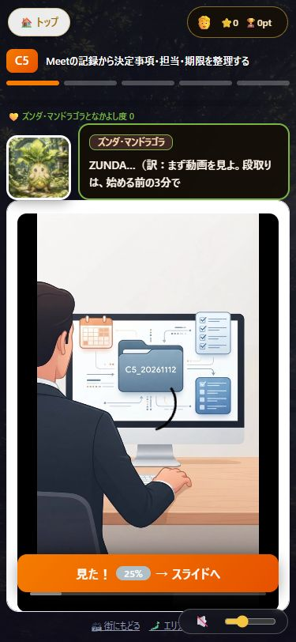

更新前：本文は2026-07-12、街は07-17、URL一覧は09-21。C5・C8には10-01の追加改訂がありました。
古い言い方：ソース28行（NotebookLM 8行、その他20行）。教材内の旧名は別に数えています。
古いバージョン：Cの本文・設定で旧モデル名・旧プラン名は0か所。長い録画の全編は未確認です。
直した数：8マスの本文・実践・40問、街の説明1件、動画8本、図解8枚、教材リンク16件。
残り：既存スライド8冊の作り直し、アーカイブ動画6本の全編確認。本番反映はしていません。

# Cエリア 更新報告

更新日：2026-11-12（日本時間）。塾長確認前のテスト公開です。

[テストサイト：Cの街](https://shozaburo.github.io/mcq-quests/stages/google64/town.html?a=C)

先に修正前の [点検報告](REPORT_C_audit.md) をコミットしました（0790965）。その後、正本を編集し、robocopyでテスト用コピーと本番アップ用コピーへそろえました。指定PCの C:\Users\matsu は存在せず作成権限もないため、利用者の承認どおり、作業フォルダー内の mcq-quests-C-review を使いました。

## マスごとの変更

| マス | 変更前 | 変更後 | 学ぶ内容・直した点 | 画面 |
|---|---|---|---|---|
| [C1](https://shozaburo.github.io/mcq-quests/stages/google64/quest.html?id=C1) | 予約スケジュール機能の構築による外部との日程調整効率化 | 予約スケジュールで日程調整の往復を減らす | 予約ページ、準備時間、利用条件を学ぶ。 | [375px](stages/google64/evidence-C/screenshots/C1-video-mobile-final.jpg)・[図解](stages/google64/evidence-C/screenshots/C1-info-browser.jpg) |
| [C2](https://shozaburo.github.io/mcq-quests/stages/google64/quest.html?id=C2) | CSV・AI連携による予定一括登録 | GeminiでCSVを作り、予定をまとめて登録する | CSVの列・日時を確認し、試験用カレンダーで1件試す。 | [375px](stages/google64/evidence-C/screenshots/C2-video-mobile-final.jpg)・[図解](stages/google64/evidence-C/screenshots/C2-info-browser.jpg) |
| [C3](https://shozaburo.github.io/mcq-quests/stages/google64/quest.html?id=C3) | 作業時間のブロック（フォーカス時間）とタスク（Tasks）の統合管理 | サイレント モードとタスクで作業時間を守る | サイレント モードとタスクを分け、使えない環境の代替手順も示す。 | [375px](stages/google64/evidence-C/screenshots/C3-video-mobile-final.jpg)・[図解](stages/google64/evidence-C/screenshots/C3-info-browser.jpg) |
| [C4](https://shozaburo.github.io/mcq-quests/stages/google64/quest.html?id=C4) | 複数アカウント・共有カレンダーの使い分けと通知設定の最適化 | カレンダーの色分け・共有・通知を整える | 色分け・共有範囲・通知を確認し、予定の見落としを減らす。 | [375px](stages/google64/evidence-C/screenshots/C4-video-mobile-final.jpg)・[図解](stages/google64/evidence-C/screenshots/C4-info-browser.jpg) |
| [C5](https://shozaburo.github.io/mcq-quests/stages/google64/quest.html?id=C5) | Meetの記録から決定事項・担当・期限を整理する | Meetの記録から決定事項・担当・期限を整理する | 録画・文字起こし・メモ作成を分け、決定事項・担当・期限・要確認を整理する。 | [375px](stages/google64/evidence-C/screenshots/C5-video-mobile-final.jpg)・[図解](stages/google64/evidence-C/screenshots/C5-info-browser.jpg) |
| [C6](https://shozaburo.github.io/mcq-quests/stages/google64/quest.html?id=C6) | コンパニオンモードと画面共有（タブ・ウィンドウ別）の使い分け技術 | コンパニオン モードと画面共有を使い分ける | 会議室の音声は1台にまとめ、共有するタブと停止操作を確認する。 | [375px](stages/google64/evidence-C/screenshots/C6-video-mobile-final.jpg)・[図解](stages/google64/evidence-C/screenshots/C6-info-browser.jpg) |
| [C7](https://shozaburo.github.io/mcq-quests/stages/google64/quest.html?id=C7) | リアルタイム翻訳字幕とAI背景生成・ノイズ除去の活用 | 翻訳字幕・背景生成・ノイズ キャンセルを使う | 翻訳字幕の誤りと、ノイズ キャンセルで人の声は消えないことを学ぶ。 | [375px](stages/google64/evidence-C/screenshots/C7-video-mobile-final.jpg)・[図解](stages/google64/evidence-C/screenshots/C7-info-browser.jpg) |
| [C8](https://shozaburo.github.io/mcq-quests/stages/google64/quest.html?id=C8) | 会議記録を報告・保存し、次の仕事につなげる | 会議記録をGemini Notebookで確かめ、報告・保存する | Gemini Notebookで原文を確かめ、報告と保存・共有を確認する。 | [375px](stages/google64/evidence-C/screenshots/C8-video-mobile-final.jpg)・[図解](stages/google64/evidence-C/screenshots/C8-info-browser.jpg) |

C5・C8は追加改訂による上書きも直し、前の文章に戻らないようにしました。セリフは学ぶ内容と理由から始め、自己紹介やHTMLタグを入れていません。Cの主とCのサイドストーリーは旧名がなく、変更していません。

## 教材を作り直した結果

[Gemini編のメインノートブック](https://notebook.google.com/notebook/809d99c3-1d05-405d-abf7-b2a0ebb48aae?authuser=0) から、マスごとの指示で再生成しました。採用した動画8本は音声の全文と5秒ごとの画像、図解8枚は画像全体を確認しました。動画は約70〜86秒の縦型です。旧ファイルは残しています。

| マス | 動画 | 図解 | 旧教材で見つけた問題 |
|---|---|---|---|
| C1 | 作り直し・接続済み | 作り直し・接続済み | 旧名の透かし、利用条件の説明を見直し |
| C2 | 作り直し・接続済み | 作り直し・接続済み | 旧動画はCSVの学習と合っていない |
| C3 | 作り直し・接続済み | 作り直し・接続済み | 旧画面名、内容が広すぎる |
| C4 | 作り直し・接続済み | 作り直し・接続済み | 旧名の透かし |
| C5 | 作り直し・接続済み | 作り直し・接続済み | メモ・録画・文字起こしの区別が必要 |
| C6 | 作り直し・接続済み | 作り直し・接続済み | 旧名の透かし |
| C7 | 作り直し・接続済み | 作り直し・接続済み | ノイズ対策の範囲を誤解する問題 |
| C8 | 作り直し・接続済み | 作り直し・接続済み | NotebookLMの旧名、チャット保存条件の説明 |

新教材の画面は説明用の模式図です。実画面そのものではなく、小さな文字に生成画像の乱れがあります。C4・C6の結びには「漏れない」「完全遮断」など強い表現があるため、実際の運用では本文どおり人が確認してください。C8の図解の「期限を設定」は、AIに期限を創作させる意味ではありません。本文・問題・実践では、原文にない担当・期限は「要確認」としています。本番前に塾長による最終確認が必要です。

## 残り・作り直しが必要な教材

既存スライドは全101ページの一覧を目視しました。全8冊に旧名NotebookLMの透かしがあります。細かな画面表示と各機能の契約条件まで全項目を再検証したものではありません。今回は指定された動画とインフォグラフィックを優先して更新し、既存PDFは残しました。

| 教材 | ページ・問題 | 残り |
|---|---|---|
| C1 slide/C1.pdf | 全12ページの旧名透かし、6ページにバッファ表記 | 再生成が必要 |
| C2 slide/C2.pdf | 全15ページの旧名透かし、CSV教材とのずれ | 再生成が必要 |
| C3 slide/C3.pdf | 全15ページの旧名透かし、4・15ページ本文にもNotebookLM | 再生成が必要 |
| C4 slide/C4.pdf | 全9ページの旧名透かし | 再生成が必要 |
| C5 slide/C5.pdf | 全14ページの旧名透かし、6〜12ページの旧設定画面・自動メモ生成表記 | 再生成が必要 |
| C6 slide/C6.pdf | 全10ページの旧名透かし、4ページにJamboard | 再生成が必要 |
| C7 slide/C7.pdf | 全12ページの旧名透かし、5ページの言語設定説明、9ページのノイズ除去表記 | 再生成が必要 |
| C8 slide/C8.pdf | 全14ページの旧名透かし、1・3・5・13ページなど本文にもNotebookLM | 再生成が必要 |
| アーカイブ動画 | 重複を除く6本。題名とリンク情報を確認。全編の音声・画面は未確認 | 全編点検が必要。旧画面があれば補足または作り直し |
| C7アーカイブ資料 | マンダラチャート関連の題名で、C7との適合を断定できない | 内容・リンク先の再確認が必要 |

この一覧は、追加で見つかった残りです。修正前の点検報告の28行には、画像内の文字を含めていません。G・Hエリア、共通intro内のC以外の説明、過去の利用者コメントには手を入れていません。

## 表示と読み込みの確認

Cの街とC1〜C8をローカルで開きました。375pxで横はみ出しなし。動画8本は新しいファイルを読み込み、図解8枚も実画像が開きました。上部ボタンと見出しの重なりをCページだけ修正し、縦型動画の枠も調整しました。

[街の画面](stages/google64/evidence-C/screenshots/town-mobile-final.jpg) ／ [確認記録](stages/google64/evidence-C/audit/browser-validation.json)

変更したJSの読み込み番号を増やしました。quest.html内の動的なC本文・実践の読み込みも更新しました。engine.jsはCのデータを動的に読み込んでおらず、今回は変更していません。C以外のデータが変わっていないことも比較しました。各コピーで以前から違うHTMLは、C関連の変更だけ反映しています。旧GitHubのboard.htmlやquests/は削除していません。

## 正式名を確かめたGoogle公式ページ

確認日：2026-11-12。モデル名を固定していないC教材へ、不要なモデル番号は追加していません。

- [NotebookLMからGemini Notebookへの名称変更](https://blog.google/innovation-and-ai/products/gemini-notebook/notebooklm-gemini-notebook/)
- [現在のGoogle AIプラン・モデル](https://one.google.com/about/google-ai-plans/)：Google AI Plus / Pro / Ultra、3.6 Flash、4 Argon、4 Carbon。利用できる機能は契約や管理者設定で異なります。
- [カレンダーのサイレント モード](https://support.google.com/calendar/answer/11190973?hl=ja)
- [予約スケジュール・準備時間](https://support.google.com/calendar/answer/10729749?hl=ja)
- [Meetのメモ作成](https://support.google.com/meet/answer/14754931?hl=ja)
- [Meetのノイズ キャンセル](https://support.google.com/meet/answer/9919960?hl=ja)
- [Meetのチャット](https://support.google.com/meet/answer/9308979?hl=ja)

メール・Chatの送信、本番re-gi.jpへのアップロードは行っていません。
